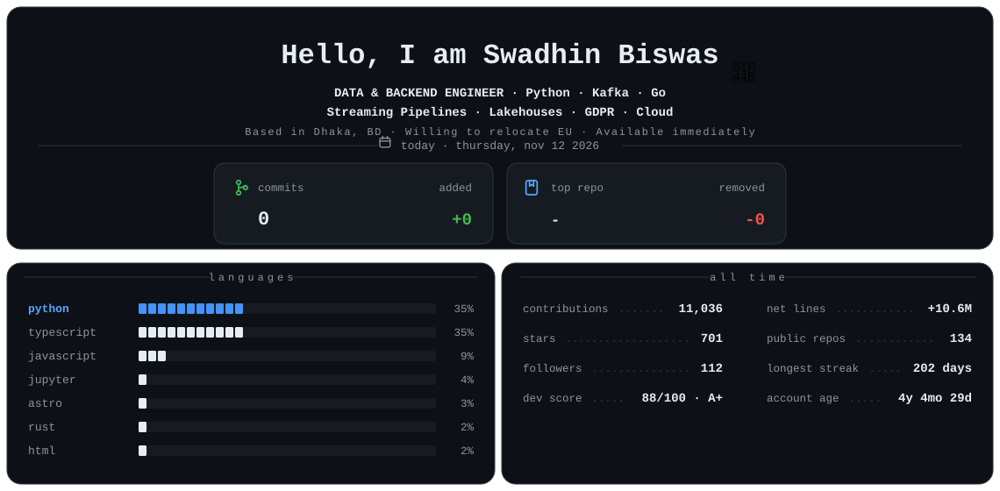
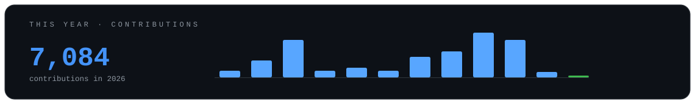

<!-- TODAY:START -->

<!-- the badge above is real time: komarev increments it on every view.
     the hero and contribution SVGs refresh hourly via github actions. -->

<!-- TODAY:END -->

<!--
  one line a recruiter can filter on. hero.svg already carries the name,
  the role, the stack and Dhaka / EU / available - so this block only
  adds seniority, target countries and the sponsorship answer.
-->

  <b>Open to mid-level Data Engineer, Backend Engineer, and Analytics Engineer roles</b> 
  available immediately · Dhaka, Bangladesh → relocating to <b>Germany · Netherlands · Austria</b>, or remote across the EU · needs visa sponsorship

  <a href="https://www.swadhin.cv/cv"><b>CV</b></a> ·
  <a href="https://swadhin.cv"><b>Portfolio</b></a> ·
  <a href="https://swadhin.cv/projects"><b>Projects</b></a> ·
  <a href="https://swadhin.cv/research"><b>Research</b></a> ·
  <a href="https://swadhin.cv/skills"><b>Skills</b></a> ·
  <a href="https://cal.com/swadhinbiswas"><b>Book a call</b></a> ·
  <a href="mailto:swadhinbiswas.dev@gmail.com"><b>Email</b></a> ·
  <a href="https://www.linkedin.com/in/swadhinbiswas">LinkedIn</a> ·
  <a href="https://x.com/swadhin_sh">X</a> ·
  <a href="https://www.youtube.com/@BitsWar">YouTube</a> ·
  <a href="https://blog.swadhin.cv">Blog</a>

### About

I build streaming pipelines, lakehouses, and the services around them. Five years in, mostly Python, Go, and SQL. The parts I like are the unglamorous ones: Kafka ingestion, dbt warehouses on DuckDB, GDPR erasure, schema-contract gates in CI.

Right now I maintain [OpencodeHub](https://github.com/swadhinbiswas/OpencodeHub), a self-hosted Git platform with CI and merge queues, and [AegisVision](https://github.com/swadhinbiswas/AegisVision), a multi-camera AI surveillance system. The latest is [Aurora](https://github.com/swadhinbiswas/Aurora), a modular reasoning architecture with a JOSS paper.

**Languages:** English (daily working language) · Bengali (native) · Hindi (conversational) · German (learning)

  

### Track record

| **1M+** | **10K+** | **&lt;100 ms** | **40%** | **668** | **3** |
|:--:|:--:|:--:|:--:|:--:|:--:|
| users reached | requests per minute | API latency | faster page loads | tests in one repo | papers and datasets |

### How I work

- **Boring technology, sharp edges removed.** Kafka, dbt, DuckDB and Postgres are my defaults; the time goes into the parts that wake you up at 2 a.m. — backpressure, schema drift, erasure.
- **Numbers with a method.** Every performance figure I publish has a script and the hardware behind it — see [JustAPI's benchmark ledger](https://github.com/swadhinbiswas/JustAPI/blob/main/BENCHMARKS.md) and the [case studies](https://swadhin.cv/projects).
- **Privacy is a design constraint, not a ticket.** GDPR erasure is a layer in the pipeline ([eurostream](https://www.swadhin.cv/projects/eurostream/)), not something bolted on after launch.
- **Own the whole path.** From the Kafka topic to the dbt mart to the API that serves it — and the on-call that keeps it honest.

### What I'm looking for

| What | Detail |
|---|---|
| **Role** | Mid-level Data Engineer, Backend Engineer, or Analytics Engineer |
| **Where** | Germany · Netherlands · Austria, or remote across the EU |
| **Start** | Immediately |
| **Visa** | Needs sponsorship for EU relocation |
| **Best way in** | [Book a 20-minute call](https://cal.com/swadhinbiswas) or [email me](mailto:swadhinbiswas.dev@gmail.com) |

<!--
  experience - EDIT BY HAND. today.py never touches this block.
  Newest first, one result-driven line per role. Keep the numbers honest
  and in sync with swadhin.cv/cv. Education is the grey line at the bottom
  because it is a filter, not a highlight.
-->
<!-- EXPERIENCE:START -->
### Experience

**May 2026 to now · Founder and maintainer · [OpencodeHub](https://github.com/swadhinbiswas/OpencodeHub)**
I build and maintain all of it myself: SSH access, CI pipelines, stacked PRs, merge queues, AI-assisted code review. Go and TypeScript, **668 tests**, with end-to-end coverage.

**2026 to now · Builder · [AegisVision](https://github.com/swadhinbiswas/AegisVision)**
Multi-camera AI surveillance and behavioural monitoring that runs on ordinary hardware: real-time face recognition with anti-spoofing liveness checks. Python.

**January 2023 to November 2025 · Co-Founder and Lead Data/Backend Engineer · The Boring Rat** *(acquired 2025, under NDA)*
Took the backend from zero to **1M+ users**: real-time event ingestion, the analytics warehouse, MLOps workflows, and the on-call. Python, FastAPI, PostgreSQL, Redis, Docker, AWS. REST APIs at **10K+ requests per minute, under 100 ms**.

**January 2021 to December 2022 · Freelance backend and automation engineer**
Delivered **8+** production systems for US and UK SaaS and e-commerce clients, from requirements through delivery and support. Django and PostgreSQL APIs handled 10K+ requests a day, and I cut page load times by **40%**.

B.Sc. Computer Science and Engineering, Daffodil International University, Dhaka · 2022 – 2026 · data structures, algorithms, database systems, machine learning, software engineering

<!-- EXPERIENCE:END -->

<!--
  featured projects - EDIT BY HAND. today.py never touches this block.
  Six only, one number each. OpencodeHub and AegisVision are deliberately
  absent: they are current roles, so they already sit in Experience.
-->
<!-- FEATURED:START -->
### Featured projects

  <video src="https://raw.githubusercontent.com/swadhinbiswas/swadhinbiswas/main/assets/justapi-banner.mp4"
         poster="https://raw.githubusercontent.com/swadhinbiswas/JustAPI/main/assets/justapi-hero.svg"
         width="100%" controls loop muted playsinline></video>

  <a href="https://github.com/swadhinbiswas/JustAPI"><b>JustAPI</b></a> — Python writes the logic. Rust does everything else. · 9 s, rendered in Rust with <a href="https://github.com/dmtrKovalenko/fframes">fframes</a>

- **[eu-air-traffic](https://www.swadhin.cv/projects/eu-air-traffic/)**: live EU airspace pipeline on Kafka, dbt, and DuckDB. Tracks ~2,000 aircraft with a 15-minute lake, published as a public Hugging Face dataset and a [Zenodo DOI](https://doi.org/10.5281/zenodo.22790201).
- **[TerraSentinel](https://www.swadhin.cv/projects/terrasentinel/)**: $0 anomaly detection over free satellite and sensor data. Four public sources feed a versioned lake, dbt and DuckDB build seven gold marts, an IsolationForest scores the anomalies, and a Databricks Asset Bundle mirrors the whole pipeline.
- **[eurostream](https://www.swadhin.cv/projects/eurostream/)**: GDPR-native streaming lakehouse. Six-layer Article 17 erasure runs in **66.95 ms mean** against a 60-second statutory window. Kafka, DuckDB, Turso.
- **[JustAPI](https://www.swadhin.cv/projects/justapi/)**: Python web framework with a Rust core. **766k req/s** hello-world, **0.48 ms p99**, 12 MB footprint, on PyPI.
- **[Aurora](https://www.swadhin.cv/projects/aurora/)**: modular reasoning architecture with a [JOSS paper](https://doi.org/10.5281/zenodo.22067754). GSM8K accuracy **47.2% → 55.6%**, confidently wrong answers **19.8% → 2.9%**.
- **[opengrammar](https://www.swadhin.cv/projects/opengrammar/)**: privacy-first Grammarly alternative. 156k-word offline engine, five runtimes, 124 stars.

Case studies and architecture notes: [swadhin.cv/projects](https://swadhin.cv/projects)

<!-- FEATURED:END -->

### Research

Three published pieces, each tied to a system I actually built:

- **[A Unified Denoising and Adaptation Framework for Self-Supervised Bengali Dialectal ASR](https://arxiv.org/abs/2509.00988)** — first author with Imran and Tuhin Sheikh. [arXiv:2509.00988](https://arxiv.org/abs/2509.00988) · [PDF](https://arxiv.org/pdf/2509.00988). WavLM with two-stage fine-tuning, tested from clean audio down to low signal-to-noise ratios; it beats fine-tuned wav2vec 2.0 and multilingual Whisper.
- **[Aurora (ART): A Modular Reasoning Architecture for Reliable and Efficient Neural Systems](https://github.com/swadhinbiswas/Aurora/blob/main/paper/paper.md)** — lead author. [paper](https://github.com/swadhinbiswas/Aurora/blob/main/paper/paper.md) · [DOI](https://doi.org/10.5281/zenodo.22067754). A six-stage transformer with an explicit uncertainty channel, published in JOSS.
- **[An Empirical Benchmark Dataset for Paillier-Based Privacy-Preserving REST API Gateways](https://doi.org/10.5281/zenodo.18655966)** — [Zenodo DOI](https://doi.org/10.5281/zenodo.18655966). Per-request telemetry measuring homomorphic-encryption overhead in REST gateways.

Full list with abstracts: [swadhin.cv/research](https://swadhin.cv/research)

<!--
  stack - text keyword lines + link to the full visual wall on the site.
  Edit by hand. The icon wall lives at swadhin.cv/skills now.
-->
<!-- STACK:START -->
### Stack

  

**Core:** Python · Go · Rust · TypeScript · SQL · Kafka · Spark · Databricks · Airflow · dbt · DuckDB · PostgreSQL · Redis · FastAPI · Django · Docker · AWS (Glue, Redshift, Athena) · Azure (Data Factory) · GCP (Dataflow, Dataproc) · PyTorch

**Working knowledge:** ClickHouse · Kubernetes · Terraform · Airbyte · Dagster · Prometheus · LangChain · OpenAI / local LLM APIs

  Data engineering · Cloud · Databases · AI · Backend · <a href="https://swadhin.cv/skills">full stack</a>

<!-- STACK:END -->

### FAQ

<b>Have you run anything at real scale?</b>

Yes. I took The Boring Rat's backend from zero to **1M+ users**, with REST APIs at **10K+ requests per minute under 100 ms**, the analytics warehouse behind it, and the on-call. Before that I delivered **8+** production systems for US and UK clients.

<b>What do you actually want next?</b>

A mid-level Data, Backend or Analytics Engineering role where I can own a system end to end — not just a ticket queue. Germany, the Netherlands or Austria are the target; EU remote works too. I need visa sponsorship for relocation.

<b>Are you only a data engineer?</b>

No. The common thread is the path from ingestion to serving: Kafka and dbt on one end, FastAPI/Go services and Postgres on the other, with the CI and privacy gates in between. I write Go and TypeScript too — OpencodeHub is a Git platform with CI and merge queues that I built solo.

<b>Do you write or publish?</b>

Three papers and datasets ([research page](https://swadhin.cv/research)), a JOSS paper for Aurora, and a blog with pieces on API design at 100,000 req/s, cheap data pipelines, and private DNS at home: [blog.swadhin.cv](https://blog.swadhin.cv).

<!--
  writing - EDIT BY HAND, or let today.py refresh it from the blog RSS feed.
  the WRITING block is replaced automatically on every run; the list below
  is the fallback used when the feed is unreachable. the intro sentence is
  generated too, so never repeat it in the About section above.
-->
<!-- WRITING:START -->
### Writing

I write about backend systems, data engineering, and building software from scratch on my blog, [blog.swadhin.cv](https://blog.swadhin.cv).

- **[Own Your Namespace: Building a Private DNS Root at Home](https://blog.swadhin.cv/blog/own-your-namespace-private-dns-root-at-home/)** · 23 Oct 2026
- **[OpenCode wrote 125,000 loose Git objects into my home directory and never committed once](https://blog.swadhin.cv/blog/opencode-btrfs-metadata-exhaustion/)** · 28 Sep 2026
- **[Designing data pipelines that stay cheap](https://blog.swadhin.cv/blog/designing-data-pipelines-that-stay-cheap/)** · 24 Sep 2026
- **[Designing an API for 100,000 requests a second](https://blog.swadhin.cv/blog/designing-an-api-for-100000-requests-a-second/)** · 24 Sep 2026

More at [blog.swadhin.cv](https://blog.swadhin.cv) · [RSS](https://blog.swadhin.cv/rss.xml) · [Atom](https://blog.swadhin.cv/atom.xml)
<!-- WRITING:END -->

<!--
  projects - auto-generated from the PROJECTS list in today.py.

  to add a project by hand, append one tuple to the matching category:
      ("repo-name", "short tagline")
  or, for a custom link target:
      ("display Name", "tagline", "https://example.com")
  the repository link, alignment and layout are regenerated
  automatically on the next run.
-->

<!-- PROJECTS:START -->

<b>More projects — all 26 repositories</b>

<pre>
DATA ENGINEERING                                RESEARCH                                        
  <a href="https://github.com/swadhinbiswas/eu-air-traffic">eu-air-traffic</a> live EU airspace pipeline        <a href="https://github.com/swadhinbiswas/contexa">contexa</a>        versioned llm agent memory     
  <a href="https://github.com/swadhinbiswas/TerraSentinel">TerraSentinel</a>  databricks satellite anomaly     <a href="https://github.com/swadhinbiswas/DOOMSDAYCS">DOOMSDAYCS</a>     offline cs encyclopedia        
  <a href="https://github.com/swadhinbiswas/eurostream">eurostream</a>     gdpr-native streaming lakehouse  <a href="https://github.com/swadhinbiswas/FAANG-Playbook">FAANG-Playbook</a> 1,400+ leetcode problems       
                                                                                                
DEVOPS                                          TOOLS                                           
  <a href="https://github.com/swadhinbiswas/OpencodeHub">OpencodeHub</a>    git platform w/ ci pipelines     <a href="https://github.com/swadhinbiswas/veet">veet</a>           universal app uninstaller      
  <a href="https://github.com/swadhinbiswas/gvx">gvx</a>            the pnpm of python               <a href="https://github.com/swadhinbiswas/lsf">lsf</a>            ls with nerd-font icons        
  <a href="https://github.com/swadhinbiswas/HiFiLinux">HiFiLinux</a>      audiophile audio for linux       <a href="https://github.com/swadhinbiswas/fetchx">fetchx</a>         neofetch rewritten in rust     
                                                  <a href="https://github.com/swadhinbiswas/Ghost">Ghost</a>          free &amp; open coding tool    
BACKEND                                           <a href="https://github.com/swadhinbiswas/ZenDownload">ZenDownload</a>    download anything, one place   
  <a href="https://github.com/swadhinbiswas/JustAPI">JustAPI</a>        zero-copy rust web framework     <a href="https://github.com/swadhinbiswas/vscode-android">vscode-android</a> a real ide for android         
                                                  <a href="https://github.com/swadhinbiswas/warren">warren</a>         rootless cli runtime           
MACHINE-LEARNING                                                                                
  <a href="https://github.com/swadhinbiswas/Aurora">Aurora</a>         modular reasoning architecture OTHERS                                          
  <a href="https://github.com/swadhinbiswas/AegisVision">AegisVision</a>    multi-camera ai surveillance     <a href="https://github.com/swadhinbiswas/linuxy">linuxy</a>         one-click appimage runner      
  <a href="https://github.com/swadhinbiswas/Ecoguard">Ecoguard</a>       self-hosted llm inference gw     <a href="https://github.com/swadhinbiswas/de-omarchy">de-omarchy</a>     modern desktop, no omarchy     
  <a href="https://github.com/swadhinbiswas/opengrammar">opengrammar</a>    open-source grammarly alt        <a href="https://github.com/swadhinbiswas/Mervelas">Mervelas</a>       ai coding cli built on bun     
                                                  <a href="https://github.com/swadhinbiswas/VidoLib">VidoLib</a>        lag-free media engine          
                                                  <a href="https://github.com/swadhinbiswas/moonshell">moonshell</a>      personal qml linux rice        
</pre>

<!-- PROJECTS:END -->

<!--
  footer - hand-edited; today.py never touches anything below the
  PROJECTS block. the last thing on the page is the ask, not a contact
  list: the nav bar at the top already carries every hire-me link.
-->

  <b>Looking for a Data or Backend role in Germany, the Netherlands, or Austria?</b> 
  <a href="https://cal.com/swadhinbiswas"><b>Book a 20-minute call</b></a> · <a href="https://www.swadhin.cv/cv">Read the CV</a> ·
  <a href="mailto:swadhinbiswas.dev@gmail.com">swadhinbiswas.dev@gmail.com</a>

  
    <a href="https://www.linkedin.com/in/swadhinbiswas">LinkedIn</a> ·
    <a href="https://x.com/swadhin_sh">X</a> ·
    <a href="https://www.youtube.com/@BitsWar">YouTube @BitsWar</a> ·
    <a href="https://blog.swadhin.cv/rss.xml">RSS</a>
  

  <em>off the clock: <svg width="16" height="16" viewBox="0 0 24 24" fill="none" stroke="currentColor" stroke-width="1.8" stroke-linecap="round" stroke-linejoin="round" style="vertical-align:-3px"><path d="M3 2v7c0 1.1.9 2 2 2h4a2 2 0 0 0 2-2V2"/><path d="M7 2v20"/><path d="M21 15V2a5 5 0 0 0-5 5v6c0 1.1.9 2 2 2h3zm0 0v7"/></svg> street-food hunter · <svg width="16" height="16" viewBox="0 0 24 24" fill="none" stroke="currentColor" stroke-width="1.8" stroke-linecap="round" stroke-linejoin="round" style="vertical-align:-3px"><rect x="2" y="2" width="20" height="20" rx="2.18"/><line x1="7" y1="2" x2="7" y2="22"/><line x1="17" y1="2" x2="17" y2="22"/><line x1="2" y1="12" x2="22" y2="12"/><line x1="2" y1="7" x2="7" y2="7"/><line x1="2" y1="17" x2="7" y2="17"/><line x1="17" y1="17" x2="22" y2="17"/><line x1="17" y1="7" x2="22" y2="7"/></svg> anime marathoner · <svg width="16" height="16" viewBox="0 0 24 24" fill="none" stroke="currentColor" stroke-width="1.8" stroke-linecap="round" stroke-linejoin="round" style="vertical-align:-3px"><path d="M4 19.5A2.5 2.5 0 0 1 6.5 17H20"/><path d="M6.5 2H20v20H6.5A2.5 2.5 0 0 1 4 19.5v-15A2.5 2.5 0 0 1 6.5 2z"/></svg> Mystery & mythology story hunter</em>

